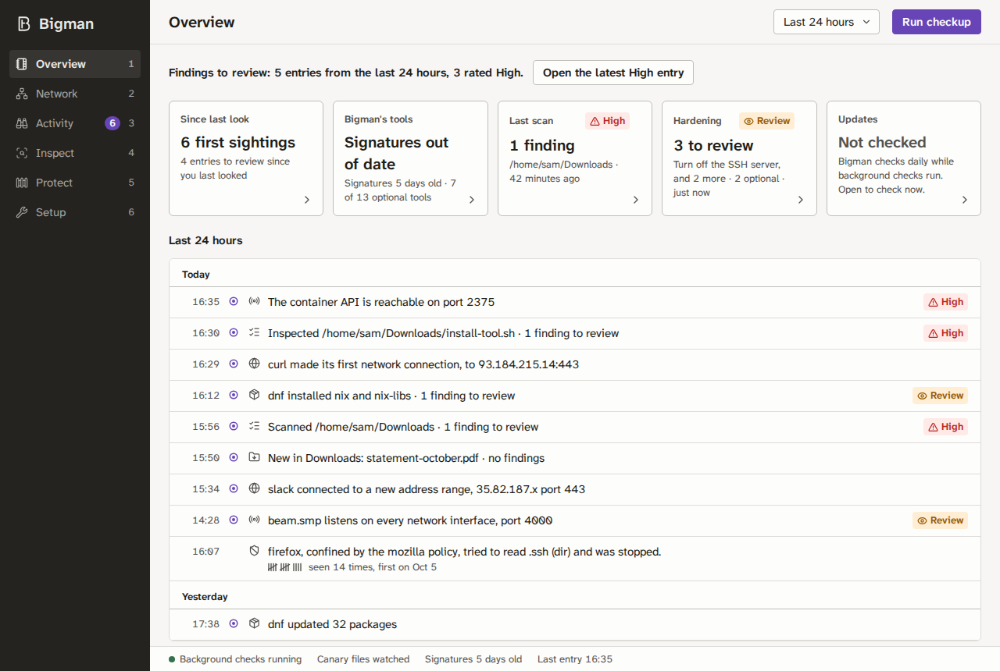

# Bigman Security Companion

Bigman helps with two questions on a Linux desktop: *is anything on my computer new or worth a look?* and *what would this thing I downloaded do if I ran it?* It inspects downloads, installer scripts, packages and cloned projects before you run them. It also notes new network activity and package changes, watches the files that start programs when you log in, and tells you which security updates matter. It has a desktop app, a command-line tool (`bigman`) and an optional Chromium extension.

Every result comes from a fixed rule with a plain explanation; there is no AI model. Results say **findings to review**, **no findings from these checks**, or **incomplete**. Bigman never says a file or computer is safe, because no scan can know that.

Bigman never deletes, moves or runs anything on its own, never uploads your files, and sends no telemetry. Anything that changes your system, such as installing a tool, quarantining a file or changing a setting, first shows exactly what will happen and waits for you to confirm.



## Install

Download the package for your distribution from the [latest release](https://github.com/Zinkelburger/bigman-antivirus/releases/latest). Each one contains `bigman` (the CLI), `bigmand` (the background service that runs every check) and `bigman-app` (the desktop app), with an application-menu entry, plus `bigman-canary-helper`, which is used only if you turn on reader identification for canaries; it sets nothing to start at login. Packages are built for x86-64 and tested on Ubuntu 22.04 and later, Debian 12 and later, Fedora 43 and later, and Arch.

```sh
sudo apt install ./bigman_VERSION_amd64.deb      # Debian, Ubuntu
sudo dnf install ./bigman-VERSION-1.x86_64.rpm   # Fedora
# Arch: build the release's PKGBUILD with makepkg -si
# Anything else: unpack bigman-VERSION-x86_64-linux.tar.gz and run ./install.sh (installs under ~/.local)
```

Check a download against the release's `SHA256SUMS`, or confirm that this repository's release workflow built it with `gh attestation verify FILE -R Zinkelburger/bigman-antivirus`.

### From source

Requirements: Linux, a current stable Rust toolchain, Node.js 22 with npm, and WebKitGTK development files for the desktop app ([build dependencies](docs/development.md#desktop-app)). Build checks were run with Rust 1.98. The CLI works without a graphical session.

```sh
./install.sh
```

This builds `bigman` (the CLI), `bigmand` (the background service that runs every check) and `bigman-app` (the desktop app), and installs them under `~/.local` with an application-menu entry. It installs no other packages and sets nothing to start at login.

## First use

1. Open **Bigman** from the application menu. A note on **Overview** lists what it does on its own (see the next section); turn off anything you don't want.
2. On **Overview**, click **Run checkup**. It only reads: which of Bigman's tools are installed, how old the malware signatures are, and which programs accept network connections.
3. In **Setup**, install ClamAV if it is missing. Then in **Protect → Scans**, click **Update signatures** and scan your Downloads folder.
4. In **Protect → Startup files**, click **Compare startup files**. The first time, this lists every file that starts programs or controls how you log in. Look through it, then click **Accept as baseline**; later comparisons show only what changed since.
5. Optional: in **Protect → Canaries**, click **Create, monitor and test…**. This puts a decoy file in your Documents folder and alerts you when anything reads it. The result should say **Local read detection verified**.
6. Optional: in **Setup → Background services**, install the services so Bigman's checks also run after you log in, not only once you open the app.

Installing tools works on Fedora, Debian and Ubuntu, from the repositories you already use, with your administrator password through polkit. Bigman does not add repositories or turn off security tools you already have.

## What runs on its own

Opening the app starts `bigmand` if it isn't already running. It runs as you, without administrator rights, and **keeps running after you close the window, until you log out**. While it runs:

- **New downloads** are checked once they finish downloading, with the inspector that fits the file (installer script, archive, launcher, package, PDF and so on) or with ClamAV when none does. Files are only read: nothing is moved, deleted or opened.
- **New project folders** cloned or unpacked into `~/Projects`, `~/src`, `~/code` (and similar folders) or Downloads are checked for what they would run when opened in an editor or terminal. Nothing in them is run.
- **Security updates** are checked once a day and shortly after package changes. This is the only automatic use of the network. It downloads public security data from your distribution and CISA's list of exploited vulnerabilities; no package list is sent.
- **Activity** records the first time each of your programs connects somewhere new, new listening programs, package installs, SELinux and AppArmor denials, SSH keys and logins, and AI-tool plugins. This only reads your own computer.
- **Canaries**: once you set up a decoy file, its monitor runs as part of `bigmand`. It stops whenever `bigmand` stops, however that happens.
- **Notifications**: findings to review appear as a desktop notification, at most one a minute. Other kinds are off until you turn them on in **Setup → Notifications**.

The first three can be turned off in **Setup → Checks that run on their own**, which the first-open note also offers. **Setup → What is collected** lists every source and whether it can read.

On a desktop that shows tray icons (KDE Plasma, or GNOME with the AppIndicator extension), closing the window also leaves the app itself in the tray; clicking the tray icon, or opening Bigman again, brings the same window back, and a right click shows its menu. On other desktops, closing the window quits the app. `bigman-app --background` starts it in the tray without opening a window, which is what a login autostart entry should run.

To stop it, click **Stop background checks…** in **Setup → Background checks** (Bigman quits too, since the open app would start it again), choose **Quit and stop background checks** from the tray menu, or run `bigman daemon stop`. It starts again the next time you open Bigman. The canary monitor stops with it. If you installed the background services, it also starts at your next login, and the daily ClamAV signature download keeps running; remove the services in **Setup → Background services** or with `bigman services --remove --apply`.

## What it checks

| Area | Examples | Where |
|---|---|---|
| Before you run something | Installer scripts (`curl … \| sh`), archives, `.desktop` launchers, `.deb`, `.rpm`, Arch and AppImage packages, npm, Python, Rust and VS Code packages, lockfiles, PDFs, cloned projects | **Inspect**, `bigman check FILE-FOLDER-OR-URL` |
| Files | ClamAV scans, quarantine and restore | **Protect → Scans**, `bigman scan` |
| Your system | Startup and login files against your baseline, package sources, security updates, hardening suggestions, AI-tool skills and plugins | **Protect** |
| What happens | Connections, listening programs, package changes with install receipts, denials, SSH access | **Activity**, **Network** |
| Decoys | Canary files that alert you when read | **Protect → Canaries**, [docs/canaries.md](docs/canaries.md) |
| Browser | Lookalike links, ClickFix pages, your own blocklists | [docs/browser-extension.md](docs/browser-extension.md) |

What each workflow does, and the limit it promises, is in [docs/features.md](docs/features.md). Every rule, with its explanation and fix, is in [docs/rules.md](docs/rules.md).

## Command line

```sh
bigman doctor                       # read-only checkup
bigman check ~/Downloads/tool.deb   # inspect a file, folder or HTTPS URL; never runs it
bigman scan ~/Downloads             # ClamAV scan
bigman changes                      # compare startup files with your baseline
bigman advisories                   # security updates
bigman history                      # past reports
bigman daemon stop                  # stop background checks
```

Commands return **0** when there is nothing to review, **1** when there are findings to review, and **2** when something could not be checked. Add `--json` for machine-readable reports. The full reference, including quarantine, the offline rehearsal sandbox and optional tools, is in [docs/cli.md](docs/cli.md).

## Your data

Reports stay in `~/.local/share/bigman` (mode 0700) and leave the computer only when you export one. They can contain local paths, file hashes and the source of scripts you inspected. Bigman sends no telemetry. The network is used by the daily security-update check, which you can turn off, and by checks you start that say so, such as fetching an installer from an HTTPS address. Bigman's private files protect against other users on the computer, not against malware already running as you.

## More

- [docs/features.md](docs/features.md): every workflow, what it does and the boundary it promises
- [docs/cli.md](docs/cli.md): command reference, quarantine, the rehearsal sandbox, limits and optional tools
- [docs/canaries.md](docs/canaries.md): decoy files and the monitor
- [docs/browser-extension.md](docs/browser-extension.md): building and connecting the extension
- [docs/development.md](docs/development.md): crates, state, tests and building the desktop app
- [docs/releasing.md](docs/releasing.md): tagging a release and what the packages contain
- [docs/threats](docs/threats/README.md): the threats Bigman addresses and how
- [SECURITY.md](SECURITY.md): reporting a vulnerability

Not implemented: telling which program read a file across the whole system, blocking files as they are opened, cleaning up after an incident, Windows and macOS, and monitoring many computers.
